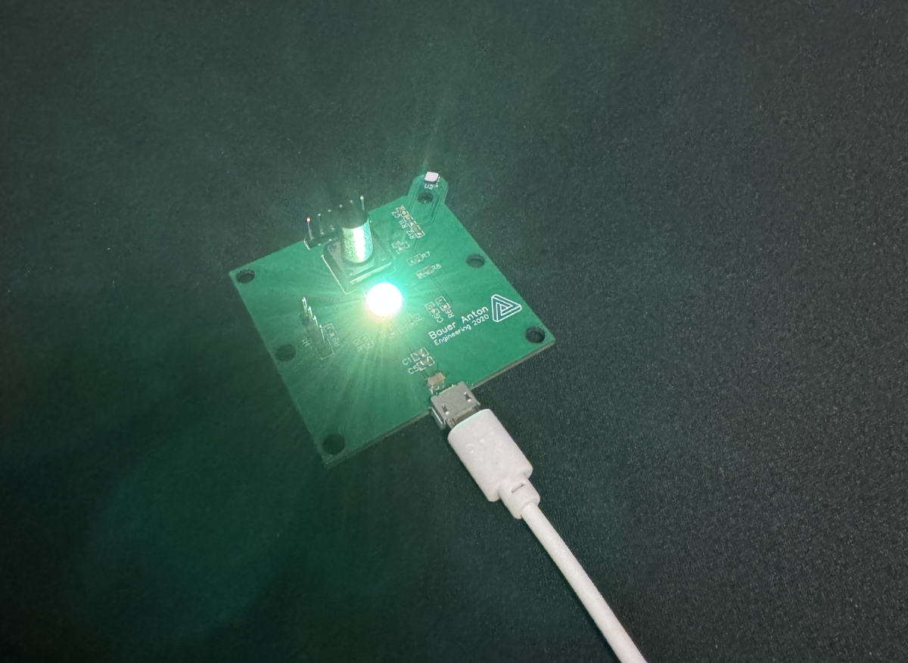
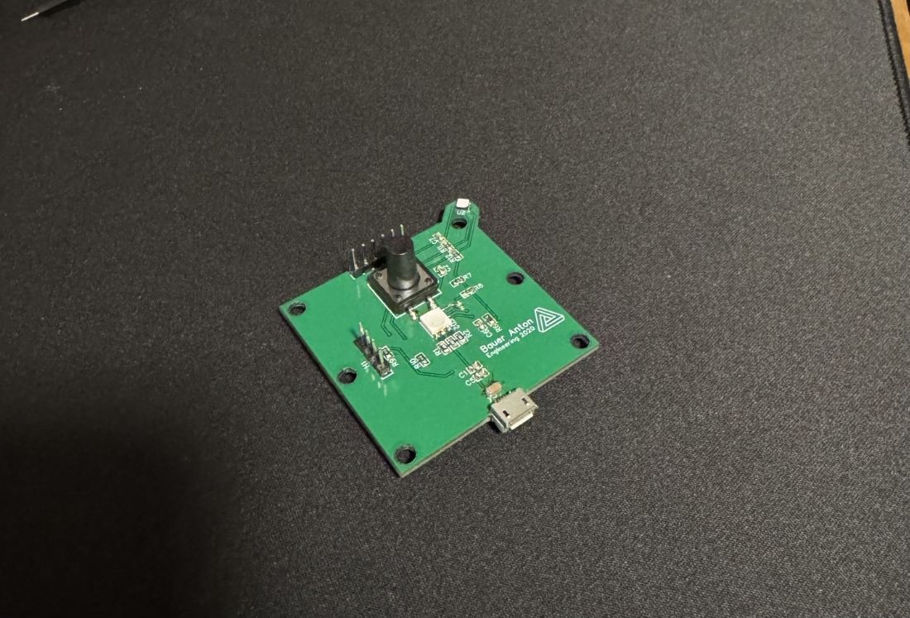
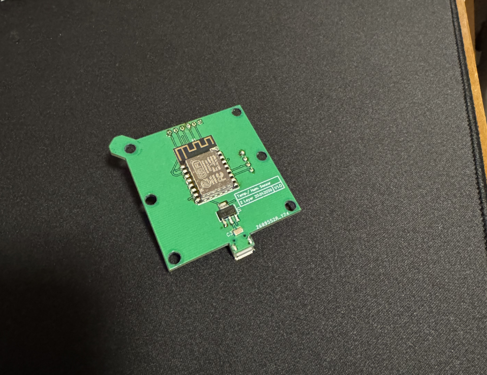

# Temp. Hum. Sensor Cube

Firmware für einen ESP-12 mit TH06/Si7006-Sensor. Der Cube misst Temperatur und
Luftfeuchtigkeit, speichert den Verlauf der letzten 7 Tage und zeigt die Temperatur auf
Tastendruck 10 s lang über eine RGB-LED an.



## Hardware

| Ordner | Inhalt |
|---|---|
| [`SCH_and_PCB/`](SCH_and_PCB) | Schaltplan als PDF, Stückliste der Platine (BOM, CSV) und Gerber-Dateien der Platine V1.0 zum Bestellen (EasyEDA) |
| [`3D parts/`](3D%20parts) | Gehäuse in drei Teilen zum Drucken (`Sensor_Cube_bot.stl`, `Sensor_Cube_middle.stl`, `Sensor_Cube_top.stl`) und das 3D-Modell der bestückten Platine (`3D_Model _V1.0 PCB.obj`) |
| [`bilder/`](bilder) | Fotos der fertigen Platine |

Die Platine hat einen ESP-12, den Sensor TH06/Si7006, eine RGB-LED, einen Taster,
einen Spannungsregler AMS1117-3.3 und eine Micro-USB-Buchse zur Versorgung. Die
vollständige Bauteilliste steht in der BOM.

Für die Gerber-Dateien den Ordner `Gerber_…` als ZIP packen und beim Platinenhersteller
hochladen, eine Anleitung steht in `How-to-order-PCB.txt`.

### Teile für den Zusammenbau

Neben der bestückten Platine und den drei gedruckten Gehäuseteilen:

| Anzahl | Teil |
|---|---|
| 2 | Zylinderschraube mit Innensechskant M4 x 10 mm |
| 4 | Zylinderschraube mit Innensechskant M4 x 20 mm |
| 4 | Druckfeder 7/32" x 11/16" |

| Vorderseite | Rückseite |
|---|---|
|  |  |

## Bauen und Flashen

Das Projekt nutzt [PlatformIO](https://platformio.org/) in VS Code.

```sh
pio run                 # bauen
pio run -t upload       # flashen
pio device monitor      # serielle Ausgabe (115200 Baud)
```

## Pinbelegung

| Funktion | GPIO |
|---|---|
| I2C SDA / SCL (Sensor) | 4 / 5 |
| LED R / G / B | 12 / 14 / 16 |
| Taster (low-aktiv) | 13 |
| TM1637 CLK / DIO (V1 ungenutzt) | 2 / 0 |

## Stand

- [x] Messung über I2C, Ausgabe über Serial
- [x] LED-Farbverlauf und Taster (kurz drücken: Temperatur 10 s anzeigen, 2 s halten: Einstellungsmodus)
- [x] Einstellungsmodus per Browser
- [x] Verlauf der letzten 7 Tage und Stromsparen

## Einstellungen

Taster 2 s halten: Die LED blinkt langsam violett, und der Cube öffnet das eigene WLAN
`SensorCube` (Passwort `sensorcube`) mit der Seite unter `http://192.168.4.1`.
Dort Werte eintragen und speichern. Ein kurzer Druck oder nochmals 2 s halten beendet den Modus ohne Speichern, ebenso 5 Minuten
ohne geöffnete Einstellungsseite.

## Verlauf und Stromsparen

Der Cube bildet alle 10 Minuten einen Mittelwert, hält die letzten 7 Tage im RAM
und sichert sie stündlich in den Flash (LittleFS). Das WLAN bleibt dabei aus,
zwischen den Messungen schläft er im Light-Sleep, ein Tastendruck weckt ihn
sofort auf.

Beim Öffnen der Seite übernimmt der Cube die Uhrzeit des Handys. Kennt er sie beim
Sichern, weiß er nach einem Stromausfall, wie lange er aus war, sobald die Seite
wieder geöffnet wird, und trägt die Zeit als Lücke im Verlauf ein. Ohne Uhrzeit
läuft der Verlauf ohne Lücke weiter.

Die Diagramme stehen oben auf der Einstellungsseite. Die Zeitachse rechnet die
Seite mit der Uhr des Geräts aus, auf dem sie geöffnet ist.
